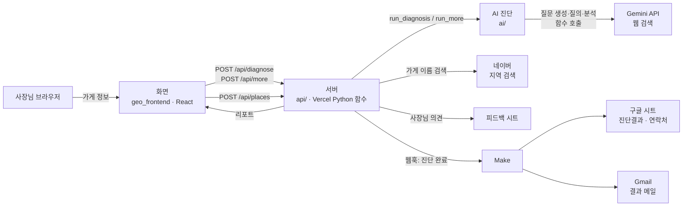
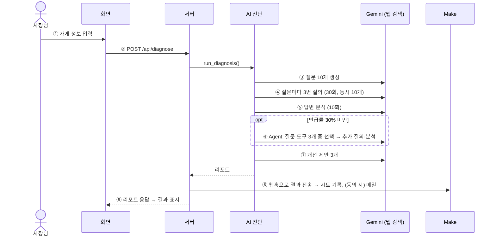

# ARCHITECTURE — 어떻게 만들었나 (구조 한 장)

> 팀장 작성, AI 부분은 AI 담당 검토 · 2026-10-29 · 무엇을 만드나는 [PRD](PRD.md), 평가 기준은 [GOAL.md](../GOAL.md)
> 기술 문서 11개(API 명세, 서버 해설, AI 활용 명세, AI 진단 입출력, AI 기술 결정 근거 등)를 한 장으로 합쳤습니다. 옛 문서는 Git 기록에 남아 있습니다.

## 1. 한 문장과 구성도

사장님이 가게 정보를 넣으면 → 서버가 Gemini에게 **손님인 척 질문 10개를 3번씩** 묻고 → 답변에 우리 가게가 몇 번 나오는지 세어 → 부족하면 **AI Agent가 원인을 더 묻고** → 개선 제안 3개를 화면에 돌려준다. 동시에 **Make가 결과를 시트에 적고 메일로 보낸다.**

| 구성 요소 | 위치 | 역할 | 담당 |
| --- | --- | --- | --- |
| 화면 | `geo_frontend/src/main.jsx`, `ReportDashboard.jsx`(결과 요약 띠·한눈에 보기), `ReportSuggestions.jsx`(개선 제안), `ReportQuestions.jsx`(질문별 AI 답변), `ReportAgent.jsx`(AI 추가 진단) | 입력·동의, 결과·추가 진단 표시, 버튼 | 화면·배포 |
| 서버 | `api/diagnose.py`, `api/more.py`, `api/places.py`, `api/feedback.py`, `server/` | 요청 확인 → AI 진단 실행 → Make 전달 → 응답 / 가게 검색은 네이버에 대신 물어봄 | 팀장 |
| AI 진단 | `ai/` (Gemini 호출은 `ai/gemini_client.py` 한 곳), 프롬프트 `ai/prompts/` | 질문 생성 → 질의 → 분석 → Agent → 개선 제안 | AI |
| 자동화 | Make 시나리오 ([`automation/make_scenario.json`](../automation/make_scenario.json)) | 시트 기록, 메일 발송 | 화면·배포 |
| 배포 | Vercel (`vercel.json`) | 화면과 서버를 한 주소로. main에 합치면 자동 배포 | 팀장 |

## 2. 진단 한 번의 흐름

| 단계 | 무엇을 | 왜 이렇게 | 코드 |
| :-: | --- | --- | --- |
| ① | 필수 칸·메뉴 1~3개 검사 (이메일은 10/31부터 결과 리포트 끝 의견 팝업에서만 받음) | 잘못된 입력으로 AI를 부르면 돈·시간 낭비 | `geo_frontend/src/main.jsx` |
| ② | 서버가 형식을 다시 검사 후 AI 진단 실행 | **API 키는 서버에만** (브라우저에 두면 노출). 주소가 공개라 화면을 거치지 않은 요청도 막음 | `api/diagnose.py` |
| ③ | 손님 말투 질문 10개 (지역 일반 2·메뉴 3·상황 3·조건 2). 상호 미포함·지역 포함 등은 **코드가 검사**, 어기면 다시 생성(최대 2번) | 손님은 가게 이름을 모르고 "망원동 돈까스 맛집"처럼 물음 | `ai/question_generator.py` |
| ④ | 질문마다 3번, 웹 검색 켜고 질의 | AI 답은 매번 달라 평균 / 동네 가게는 검색 없이는 모름 / 300초 제한 때문에 동시에 | `ai/diagnosis.py` `run_queries()` |
| ⑤ | 언급 여부·순위·소개 문구·함께 나온 가게·출처 (3장 측정 방법) | 같은 질문의 답 3개를 한 번에 분석 → 분석 호출 30회 → 10회 | `ai/diagnosis.py` `analyze_all()` `summarize()` |
| ⑥ | **할지 말지는 규칙**(30% 미만), **무엇을 물을지는 AI**. 도구 3개를 함수로 주면 Gemini가 1~2개를 골라 이유와 함께 호출 → 코드가 검사 후 실행 | G3 "AI가 2개 이상의 도구 중 스스로 고름". AI가 가게를 **모르는지 / 알지만 추천 안 하는지** 구분 | `ai/agent.py` `run_agent()`, `ai/gemini_client.py` `choose_tools()` |
| ⑦ | 제목·할 일·근거 3개. 근거는 진단 결과 안의 숫자·가게 이름만 | 근거 없는 약속("노출 30% 상승") 방지 | `ai/diagnosis.py` `suggest()` |
| ⑧ | 결과를 칸 21개(한 줄짜리 20개 + 메일 본문 HTML 1개)로 Make에 전송 | 시트·메일을 코드 없이 연결, G3 "이벤트로 2개 이상 서비스가 사람 없이 이어짐". Make가 실패해도 화면 결과는 그대로 | `server/make_sender.py`, `server/report_mail.py` |

**"더 자세히 진단하기" 버튼**: ⑥이 자동으로 안 돌았을 때만 보임(`more_available`). 서버는 요청이 끝나면 내용을 잊으므로 **화면이 1차 리포트를 통째로 다시 보내고**(`POST /api/more`), 서버가 Agent를 1번 실행한 뒤 개선 제안을 다시 만든다(`run_more()`). 진단 1회당 1번.

**호출 수와 시간**

| 단계 | 호출 | 웹 검색 |
| --- | :-: | :-: |
| 질문 생성 | 1 (규칙 위반 시 최대 3) | |
| 질의 (10개 × 3회) | 30 | ○ |
| 답변 분석 | 10 | |
| Agent 도구 선택 + 추가 질의(최대 2개 × 3회) + 추가 분석 | 1 + 6 + 2 | ○ (6) |
| 개선 제안 | 1 | |
| **합계** | **최대 51** (Agent 없으면 42, 버튼 +10) | **36** |

- 배포 환경 실측: 진단 약 20~35초, 버튼 약 13초. 진단 1회 비용 약 $0.1 (선불 충전, 자동 충전 끔)

## 3. 측정 방법

| 지표 | 정의 |
| --- | --- |
| 언급 판정 | 답변 1개 단위, 여러 번 나와도 1건. **코드 판정**(공백·특수문자 제거, 돈가스/돈까스 통일, 지점명 제거 후 포함 여부) + **AI 판정**(약칭·다른 지역 같은 이름 구분). 최종은 AI 판정, 둘이 다르면 `mismatch`로 기록. 출처 링크에만 있고 본문에 없으면 미언급 |
| 언급률 | 언급된 답변 ÷ **정상 답변**. 실패·빈 답변·"정보 없음" 답변은 분모에서 제외 → 실패를 "언급 없음"으로 잘못 세지 않음. 질문 유형별로도 계산 |
| 순위 | 여러 가게를 나열한 답변에서 우리 가게가 처음 나온 위치. 평균 순위와 1위 횟수 |
| 소개 문구 | AI가 우리 가게를 설명한 말 (최대 50자, 긍정·중립·부정) |
| 함께 나온 가게 | 답변에 같이 나온 다른 가게 상위 3곳과 소개 문구 |
| 출처 | 웹 검색 출처를 사이트 이름으로 블로그·지도·리뷰 등으로 분류 |
| 신뢰도 낮음 | 정상 답변이 2/3 미만이면 표시 |

## 4. AI 설정과 근거

| 항목 | 값 | 근거 |
| --- | --- | --- |
| 모델 | `gemini-3.5-flash-lite` | 같은 조건 진단 28~32초 vs 3.8-flash 177~191초 (10/22). 둘 다 3회 점검 통과 |
| 웹 검색 | 켬 (Gemini Grounding, 유료 키) | 끄면 가상 가게도 "숨은 맛집"이라고 지어냄(10/19). 켜면 테스트 상호 2곳 모두 언급 0회 |
| 반복 | 질문당 3회 | 답이 매번 달라 평균으로 판단 |
| temperature | 질문 생성 0.7 / 답변 분석 0 / 개선 제안 0.3 | 질문은 자연스럽게, 판정은 같은 답이면 같은 결과로, 제안은 근거에 충실하게 |
| 동시 호출 | 배포 10개 (코드 기본 3) | Vercel 실행 1회 300초 제한. 순차로 보내면 약 164초 (10/19 계산) |
| 호출 제한 시간 | 60초 | 응답 없이 2분 가까이 멈춘 사례(10/19) |
| 재시도 | 한도 초과(429)는 최대 3번, 모델 이름·키 오류는 재시도 안 함 | 모델 이름 오류로 404가 약 40회 쌓인 사례(10/22) |

- 프롬프트는 코드에 직접 쓰지 않고 [`ai/prompts/`](../ai/prompts/) 파일로 관리, 바꿀 때마다 [`CHANGELOG.md`](../ai/prompts/CHANGELOG.md)에 이유와 결과 기록

## 5. 약속 (화면 ↔ 서버 ↔ Make)

**요청 `POST /api/diagnose`**

| 칸 | 형식 | 규칙 |
| --- | --- | --- |
| `store` | 문자열 | 필수, 1~30자 |
| `region` | 문자열 | 필수, "동"까지 (읍·면은 받지 않음) |
| `menus` | 문자열 목록 | 필수, 1~3개 |
| `station` | 문자열 | 선택. **10/31부터 화면에서 보내지 않음** (빈칸이면 질문 10개 모두 동 이름) |
| `email`, `consent` | 문자열, true/false | 선택. **10/31부터 화면에서 보내지 않음** (이메일은 `/api/feedback`에서). 보내면 `consent`가 정확히 true이고 형식이 맞을 때만 Make로 넘김. AI에는 넘기지 않음 |

예: `{"store": "초록별돈까스 망원점", "region": "서울 마포구 망원동", "menus": ["등심돈까스"], "email": "", "consent": false}`

**응답 = 리포트** (화면이 쓰는 칸)

| 칸 | 뜻 |
| --- | --- |
| `ok`, `error`, `problems` | 성공 여부. 실패면 사장님이 읽을 문장 |
| `summary.mention` | 언급률과 분모 (`valid`, `mentioned`, `rate`) |
| `summary.by_type` | 질문 유형별 언급 |
| `summary.rank`, `summary.descriptions` | 평균 순위, AI가 우리 가게를 소개한 말 |
| `summary.competitors`, `summary.sources` | 함께 나온 가게, 출처 종류별 개수 |
| `summary.low_reliability` | 신뢰도 낮음 |
| `questions[]`, `answers[]` | 질문 10개, 답변 원문 30개(출처·판정 포함) |
| `agent` | `trigger`(auto/button), `reason_to_run`, `trace[]`(고른 도구 `tool_label`, 이유 `why`, 질문, 결과) |
| `more_available` | true면 "더 자세히 진단하기" 버튼 표시 |
| `suggestions[]` | 개선 제안 3개 (`title`, `detail`, `evidence`) |
| `notice` | "AI가 생성한 추정치" 안내, **항상 표시** (G7) |
| `delivery` | 서버가 붙임: 메일 요청 여부(`requested`), Make 전달 성공(`sent`), 실패 이유(`error`) |

**HTTP 상태**: 진단 성공·입력 오류·AI 실패는 모두 **200 + `ok`로 구분** (화면이 한 가지 모양만 처리) / JSON이 아님 400 / POST 아님 405 / 예상 못 한 오류 500

**`POST /api/more`**: `{"report": 1차 리포트, "email", "consent"}` → `agent`·`suggestions`가 새로 채워진 리포트 + `more_error`(실패 시 안내 한 줄). 이미 추가 진단한 리포트면 실행하지 않음

**`POST /api/places`** (가게 검색): `{"query": "명동교자 명동"}` → `{"ok", "error", "places": [{"name", "category", "address"(지번), "road_address", "region", "region_note", "menus"}]}` 최대 5개. `menus`는 업종(예: 한식>칼국수,만두)에서 뽑은 대표 메뉴 후보(최대 3개, "카페"처럼 큰 분류만 있으면 빈 목록). `region`은 지번 주소에서 시·구·동까지 잘라 만든 값, `""`이면 `region_note`(읍·면 미지원, 동을 못 찾음)를 보여 주고 직접 입력. 검색어 2~40자, 네이버 열쇠는 서버 환경 변수에만. 네이버 클라우드 NAVER API HUB 주소(`naverapihub.apigw.ntruss.com/search/v1/local`)와 헤더(`X-NCP-APIGW-API-KEY-ID`·`X-NCP-APIGW-API-KEY`) 사용, 하루 한도 25,000회

**`POST /api/feedback`** (사장님 의견 팝업 "의견을 들려주시면 리포트를 메일로 발송해드립니다"): `{"clarity": 1~5, "accuracy", "competitors", "useful", "comment"(300자), "name", "email", "consent": true, "report": 리포트 전체}` → `{"ok", "feedback_saved", "mail_sent", "error"}`. 서버가 ① 의견만 `FEEDBACK_WEBHOOK_URL`(피드백 시트, 이름·이메일 없음)로, ② 리포트를 Make로 보내(`event: "feedback_report"`, `name`·`report_html` 칸 포함) 연락처 시트 기록 + 리포트 메일 발송. 이메일은 동의가 true일 때만. 피드백 시트 기록은 구글 Apps Script 웹 앱([`automation/feedback_sheet.gs`](../automation/feedback_sheet.gs)). 저장 성공은 Apps Script가 `ok`라고 답할 때만으로 보고, 실패하면 Vercel 로그에 `[feedback]`으로 시작하는 이유 한 줄(주소 비어 있음, 구글 로그인 화면으로 이동 등)을 남김(10/31)

**서버 → Make 웹훅 (칸 21개)**

| 칸 | 진단결과 시트 | 연락처 시트 | 메일 |
| --- | :-: | :-: | :-: |
| `event`, `station`, `questions_text`, `agent_trigger`, `low_reliability`, `model` | ○ | | |
| `region`, `menus`, `mention_rate`, `mention_text`, `by_type_text`, `competitors_text`, `agent_text`, `suggestions_text`, `notice` | ○ | | ○ |
| `store` | ○ | ○ | ○ |
| `diagnosed_at` (한국 시각) | ○ | ○ | |
| `email`, `consent` (동의했을 때만) | | ○ | `email` = 받는 사람 |
| `name` (의견 팝업에서 동의했을 때만, 10/31 추가) | | 연결 필요 | 연결 필요 |
| `report_html` (메일 본문: 화면과 같은 형식의 리포트 HTML, 메일 보낼 때만, 10/31 추가) | | | 연결 필요 (본문 형식 Raw HTML) |

- 진단결과 시트에는 이메일을 넣지 않음. Make 필터: 이메일이 있고 동의가 true일 때만 연락처 기록·메일 발송. 연락처 시트는 2026-11-24 파기 (칸 연결: [블루프린트](../automation/make_scenario.json))
- 메일 본문 `report_html`은 서버([`server/report_mail.py`](../server/report_mail.py))가 화면 리포트와 같은 순서로 만듦. 메일 프로그램은 질문 펼치기·버튼을 막아 질문은 "3번 중 몇 번 언급"까지만, 답변 원문은 Gmail이 약 100KB 넘는 메일을 잘라서 넣지 않음. AI 답변에서 온 글자는 기호를 바꿔 넣음(메일 모양이 깨지지 않게)
- 웹훅 주소·API 키는 Vercel 환경 변수에만 (목록: [README 5-4](../README.md))

## 6. 주요 결정과 근거

| 결정 | 버린 대안 | 근거 |
| --- | --- | --- |
| Agent: 질문 도구 3개를 함수로, Gemini가 선택 | 규칙으로 도구 선택 / 질문 문장만 AI에게 받기 / 여러 단계 반복 | 앞의 둘은 G3 불인정, 반복은 시간·비용 예측 불가. 실제 가게에서 "알지만 추천 안 함"을 구분함(10/26: 기본 0/30 → 직접 지명형 3/3) |
| Agent 실행 여부는 규칙(언급률 30%) | AI가 실행 여부까지 판단 | 같은 입력이면 같은 판단 → G4 "3회 중 2회" 보장 (테스트 상호 3회 모두 같은 판단) |
| 질문은 4유형 고정 + AI 문장 + 코드 검사 | 사장님 직접 입력 / 고정 템플릿 / AI 자유 생성 | 입력 부담 없이 자연스럽고 규칙도 지킴. 3번 시도로 바꾼 뒤 진단 12회 모두 질문 생성 성공 |
| 가게 검색: 네이버 지역 검색을 서버가 대신 호출 | 카카오 우편번호(주소만, 가게 이름 검색 불가) / 카카오 로컬(무료 사용량이 계정당 첫 앱에만) / 화면에서 바로 호출(열쇠 노출) | 가게 이름으로 찾고, 열쇠는 서버에만. 결과 최대 5개라 "이름 + 동네"로 안내 (10/31) |
| Vercel Python 함수, Python 기본 도구만 | Supabase(AI 코드 재작성) / FastAPI·Flask(새 라이브러리) | 화면과 한 주소, 새 라이브러리 0개 → 코드 전부를 설명 가능 |
| 요청 1번으로 끝까지 기다림 | 단계별 요청 / 접수 후 확인 | 가장 단순. 결과 저장소가 필요 없음 |
| 서버는 결과를 기억하지 않음 → 버튼은 화면이 리포트를 다시 보냄 | 서버에 저장 | Vercel은 요청마다 새로 시작, 저장소 추가 없이 해결 |
| 결과 저장은 Make → 구글 시트 (요약만) | 데이터베이스 / 답변 원문까지 | 코드 없이 저장, 팀 전원 열람. 원문은 하나가 수천 자라 제외 |
| 리포트 메일은 서버가 HTML로 만들어 Make에 넘김 (10/31) | Make 안에서 HTML 틀 짜기 / 메일엔 요약 + 화면 링크 / PDF 첨부 | 코드가 레포에 남아 테스트·설명 가능, 새 라이브러리 0개. 링크는 리포트 저장소가 새로 필요, PDF는 라이브러리·한글 글꼴 문제 |
| 출처를 사이트 이름으로 분류 | 출처 주소로 분류 | Gemini가 Google 중간 주소를 줘서 131개 모두 "기타"였음(10/22) |
| **RAG·Long-term Memory는 쓰지 않음** `[AI 담당 확인]` | 사용 | 진단은 매번 "지금 AI가 어떻게 답하나"를 재는 일이라 미리 모은 문서를 넣으면 측정이 왜곡됨. 웹 검색은 Gemini 기능(Grounding)으로 사용. 로그인·이력이 없어 사용자별 기억할 정보도 없음 |

## 7. 알려진 한계

- AI 답은 매번 달라 언급률이 회차마다 조금씩 다름 → 3회 평균, 화면·메일에 고지
- 실제 ChatGPT·Gemini 앱 답변과 다를 수 있음 (API + 웹 검색 기준)
- 진단 결과를 저장하지 않아 재진단 비교·이력은 없음 (메일로 보관)
- 선불 잔액이 0이면 서비스가 멈춤 → 제출·테스트 전 확인 ([GOAL.md 6장](../GOAL.md))
