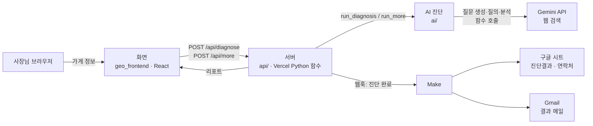

# 기능 요구 명세서

> 팀장 작성 · 2026-10-22 · v0.2 (10/27 구현 현황 갱신) · 제출물 ②
> 근거 문서: [기획서](기획서.md) · [ARCHITECTURE](ARCHITECTURE.md) · [GOAL.md](../GOAL.md)
> 서비스 주소: https://codyssey-final-geo.vercel.app/ (로그인 없음)

---

## 0. 한 줄 요약

외식업 사장님이 상호·지역·대표 메뉴를 넣으면, 손님이 물을 법한 질문 10개를 AI(Gemini, 웹 검색)에 3번씩 물어 **우리 가게가 답변에 몇 번 나오는지(언급률)** 진단하고, 필요하면 **AI Agent가 추가 질문을 골라** 원인을 좁힌 뒤 개선 제안 3개를 화면과 메일로 전달한다.

## 1. 기능 요구사항

Must 기능은 3개입니다. 과정 공지(Must 10개 내외 권고, 연관 기능은 워크플로우 단위로 통합)에 따라 사장님이 경험하는 흐름 단위로 묶었습니다 (README 8-1, 10/19 결정).

### Must ① 진단 실행

| 항목 | 내용 |
| --- | --- |
| 사용자 | 외식업 사장님 |
| 입력 | 상호(필수, 1~30자) · 지역(필수, 시·구·동) · 대표 메뉴(필수, 1~3개) |
| 처리 | 입력 확인 → 손님 질문 10개 생성(지역 일반형 2·메뉴형 3·상황형 3·조건형 2) → 질문마다 Gemini에 3회 질의(웹 검색) → 답변 30개 분석(언급 여부·순위·소개 문구·함께 나온 가게) → 집계 → 개선 제안 3개 생성 |
| 출력 | 언급률(정상 답변 중 언급된 답변 비율), 질문 유형별 결과, 함께 나온 가게 상위 3곳, AI가 우리 가게를 소개한 말, 개선 제안 3개, "AI가 생성한 추정치" 안내 |
| 실패 시 | 입력 오류·AI 응답 실패를 사장님이 이해할 수 있는 문장으로 안내 (AI 호출 전 입력 오류는 비용 없이 즉시 안내) |
| 관련 기술 | 생성형 AI (질문 생성·답변 분석·개선 제안) |

### Must ② AI Agent 추가 진단

| 항목 | 내용 |
| --- | --- |
| 실행 조건 | 언급률 30% 미만이면 **자동** 1회 / 그 외(또는 자동 실행 실패)에는 결과 화면의 **"더 자세히 진단하기" 버튼**으로 1회 |
| 처리 | 질문 도구 3개(직접 지명형·경쟁 비교형·상황 세분형)를 각각 함수로 Gemini에 제공 → **Gemini가 함수 호출로 1~2개를 스스로 선택**하고 질문 문장과 고른 이유를 채움 → 코드가 규칙 검사(지역 포함, 상호 포함 여부) 후 질문마다 3회 질의·분석 → 개선 제안을 추가 진단 결과까지 넣어 다시 생성 |
| 출력 | 추가 진단 영역: 실행 이유, AI가 고른 질문 종류, 고른 이유, 추가 질문과 결과(언급/정상 답변) |
| 제한 | 진단 1회당 추가 질의 1번 (같은 결과로 버튼을 다시 누르면 안내 문장만 표시) |
| 관련 기술 | **AI Agent** (평가기준 G3: LLM이 2개 이상의 도구·함수 중 호출 대상을 스스로 정함) |

### Must ③ 결과 자동 전달

| 항목 | 내용 |
| --- | --- |
| 시작 | 두 가지 이벤트 (10/31 변경) ① **진단 완료**(또는 추가 진단 완료) → 서버가 Make 웹훅 호출 ② 결과 리포트 끝 **의견 팝업 제출** → 서버가 의견은 피드백 시트로, 리포트는 Make 웹훅으로 |
| 처리 | ① Make: 구글 시트 `진단결과`에 기록 ② Make: `진단결과`에 기록 → 시트 `연락처`에 기록 + Gmail로 **리포트 메일 발송**(본문은 서버가 만든, 화면과 같은 형식의 리포트) / 피드백 시트(Apps Script)에 의견 기록 (모두 사람 개입 없음) |
| 출력 | 구글 시트의 진단 기록, 사장님 메일함의 리포트 메일, 피드백 시트의 의견 |
| 조건 | 이메일은 입력 화면에서 받지 않고 **의견 팝업에서 이름과 함께, 개인정보 수집·이용에 동의한 경우에만** 받음. 진단결과·피드백 시트에는 이름·이메일을 넣지 않음 |
| 관련 기술 | **자동화 워크플로우** (평가기준 G3: 이벤트로 시작해 2개 이상 서비스가 사람 개입 없이 이어짐) |

### 이번 범위에서 뺀 것 (Must 아님)

| 기능 | 뺀 이유 |
| --- | --- |
| ChatGPT·Claude 동시 진단 | 1차는 Gemini로 끝까지 완성 (10/14 결정). AI 호출을 한 파일에 모아 두어 추가는 가능 |
| 주기적 재진단·이력 대시보드 | 9일 일정 안에 주기 실행을 시연하기 어려움 (10/17 결정) |
| 읍·면 지역 | 테스터 모집을 동 지역으로 한정 (10/19 결정) |

## 2. 비기능 요구사항

| ID | 구분 | 요구사항 | 구현 |
| --- | --- | --- | --- |
| NF-1 | 입력 검증 | 화면과 서버 양쪽에서 입력 확인. 잘못된 입력은 AI를 부르기 전에 안내 | 화면 `geo_frontend/src/main.jsx`, 서버 `api/diagnose.py`, AI `ai/diagnosis.py` `check_input()` |
| NF-2 | 개인정보 (G7) | 이메일은 선택이며 10/31부터 입력 화면이 아닌 의견 팝업에서 이름과 함께 받음. 수집 항목·목적·보관 기간·거부 권리 고지 후 동의 시에만 입력 가능. AI에는 이메일을 넘기지 않음. 2026-11-24 파기 | 화면 동의 체크, `server/http_utils.py` `consented_email()` |
| NF-3 | AI 생성 표시 (G7) | 모든 결과 화면·메일에 "AI가 생성한 추정치" 안내. 정상 답변이 2/3 미만이면 "신뢰도 낮음" 표시 | 리포트 `notice`, `summary.low_reliability` |
| NF-4 | 응답 시간 | 진단 1회가 Vercel 실행 제한 300초 안에 끝남 | 동시 호출 10개, 모델 gemini-3.5-flash-lite. 실측 22.5~32초, 버튼 13초 (10/21~22) |
| NF-5 | 진단 신뢰도 | 같은 질문 3회 반복, 언급률 분모는 정상 답변 수. 같은 입력 3회 중 2회 이상 기대 결과 (G4) | `ai/diagnosis.py`, 품질 점검 기록 `docs/작업기록/품질점검.md` |
| NF-6 | 비밀값 보호 | API 키·웹훅 주소는 환경 변수에만. 저장소·로그에 남기지 않음 | `.gitignore`, Vercel 환경 변수, `server/make_sender.py` 오류 기록 방식 |
| NF-7 | 비용 통제 | 과제 전용 Gemini 프로젝트, 선불 충전·자동 충전 끔 → 충전액 이상 지출 없음 | 기획서 3-2 |
| NF-8 | 가용성 (G2) | 결과 안내 전까지 서비스 유지. 로그인 없이 배포 주소로 바로 사용 | Vercel, 제출 전 잔액 확인 ([GOAL.md](../GOAL.md) 6장) |

## 3. 시스템 아키텍처

| 구성 요소 | 위치 | 역할 | 담당 |
| --- | --- | --- | --- |
| 화면 | `geo_frontend/` | 입력·동의, 결과·추가 진단 표시, 버튼 | 화면·배포 |
| 서버 | `api/diagnose.py`, `api/more.py`, `server/` | 요청 확인, AI 진단 실행, Make 전달, 응답 | 팀장 |
| AI 진단 | `ai/` | 질문 생성 → 질의 → 분석 → Agent → 개선 제안 | AI |
| 자동화 | Make 시나리오 (`automation/make_scenario.json`) | 시트 기록, 메일 발송 | 화면·배포 |
| 배포 | Vercel (`vercel.json`) | 화면과 서버를 한 주소로 배포 | 팀장 |

- 화면과 서버가 같은 주소라 별도 설정 없이 `/api/...`로 호출
- 서버는 요청마다 새로 켜져 상태를 기억하지 않음 → "더 자세히 진단하기"는 화면이 1차 리포트를 다시 보냄
- 요청·응답·AI 리포트 칸: [ARCHITECTURE 5장(약속)](ARCHITECTURE.md)

## 4. AI 활용 명세

| 단계 | AI 방식 | 하는 일 | 코드 | 프롬프트 |
| --- | --- | --- | --- | --- |
| 질문 생성 | 생성형 AI + 코드 검사 | 손님 말투 질문 10개. 개수·상호 미포함·지역 포함은 코드가 검사, 어기면 최대 3번 재생성 | `ai/question_generator.py` | `ai/prompts/question_generation.md` |
| 답변 수집 | 생성형 AI (웹 검색) | 질문을 손님 문장 그대로 3회씩 질의, 출처 사이트 기록 | `ai/diagnosis.py` `run_queries()` | (질문 원문) |
| 답변 분석 | 생성형 AI + 코드 판정 | 언급 여부(코드 판정과 비교)·순위·소개 문구·함께 나온 가게 | `ai/diagnosis.py` `analyze_question()` | `ai/prompts/answer_analysis.md` |
| 추가 진단 | **AI Agent** (함수 호출) | 질문 도구 3개 중 1~2개 선택, 이유 기록 | `ai/agent.py` `run_agent()` | `ai/prompts/agent_decision.md` |
| 개선 제안 | 생성형 AI | 진단 결과 안의 숫자·가게 이름만 근거로 실행 가능한 제안 3개 | `ai/diagnosis.py` `suggest()` | `ai/prompts/improvement.md` |

- 모든 Gemini 호출은 `ai/gemini_client.py` 한 곳을 거침 (모델 교체·다른 AI 추가 시 이 파일만 수정)
- 모델·설정 근거 (temperature, 반복 횟수, 동시 호출 등): [ARCHITECTURE 4장(AI 설정)](ARCHITECTURE.md)
- 프롬프트 변경 이유: [`ai/prompts/CHANGELOG.md`](../ai/prompts/CHANGELOG.md)

## 5. 필수 기술 요소별 코드 위치 (평가기준 G3)

| 기술 요소 | 인정 조건 | 우리 구현 | 코드 위치 |
| --- | --- | --- | --- |
| AI Agent | LLM이 2개 이상의 도구·함수 중 호출 대상을 스스로 정함 | 질문 도구 3개를 함수로 정의 → Gemini 함수 호출(`mode=ANY`)로 1~2개 선택 → 코드가 검사 후 실행 → 고른 도구·이유를 리포트 `agent.trace`에 기록 | 도구 정의 `ai/agent.py` `TOOLS` · 실행 `ai/agent.py` `run_agent()` · 함수 호출 `ai/gemini_client.py` `choose_tools()` · 버튼 `ai/diagnosis.py` `run_more()`, `api/more.py` |
| 자동화 워크플로우 | 이벤트로 시작해 2개 이상 서비스가 사람 개입 없이 이어짐 | 진단 완료 이벤트 → 서버가 Make 웹훅 호출 → 구글 시트 기록 + Gmail 발송 | 웹훅 호출 `server/make_sender.py` `send_to_make()` (`api/diagnose.py`, `api/more.py`에서 호출) · 시나리오 정의 [`automation/make_scenario.json`](../automation/make_scenario.json) |

## 6. 평가자 확인 안내

| 확인할 것 | 입력 |
| --- | --- |
| Agent 자동 실행 | **평가자용 테스트 상호** (실존하지 않는 이름 → 언급률 0% → 자동 추가 진단)  A: 상호 `초록별돈까스 망원점` · 지역 `서울 마포구 망원동` · 메뉴 `등심돈까스`  B: 상호 `달무리칼국수 명동점` · 지역 `서울 중구 명동` · 메뉴 `칼국수` |
| Agent 버튼 실행 | 실존하는 유명 가게 (예: 상호 `명동교자` · 지역 `서울 중구 명동` · 메뉴 `칼국수, 만두`) → 언급률이 높아 자동 실행 안 함 → "더 자세히 진단하기" 버튼 |
| 리포트 메일 | 위 진단 결과를 맨 아래까지 스크롤 → 의견 팝업에서 1~4번 답 + 이름·평가자 메일 입력 + 동의 체크 → [의견 보내고 리포트 받기] |
| 시트 기록 | 팀 구글 시트는 테스터 가게 정보가 있어 공개하지 않음 → Make 실행 기록과 `진단결과` 시트 화면 캡처를 [`docs/images/make/`](images/make/)에 첨부 (평가자 진단 시각과 대조 가능하도록 실행 일시 포함) |

- 테스트 상호는 10/22 웹 검색·지도앱(네이버·카카오)으로 같은 이름 가게가 없음을 확인. 웹 검색 켬 3회 모두 언급률 0% → 자동 추가 진단 ([품질 점검 기록](작업기록/품질점검.md))
- AI 답변은 매번 달라 숫자는 회차마다 다를 수 있음 → 아래 기대 결과는 "무엇이 표시되는지"로 적음

## 7. 구현 현황

> 마지막 갱신 10/27. 상태: ✅ 완료 · 🔶 일부 완료 · ⬜ 시작 전
> 확인 근거: 배포 사이트 실제 화면 확인(10/25), 같은 입력 3회 점검 [`docs/작업기록/품질점검.md`](작업기록/품질점검.md)

| 기능명 | Must 여부 | 구현 여부 | 확인 방법 | 기대 결과 |
| --- | :-: | :-: | --- | --- |
| ① 진단 실행 | Must | ✅ 배포 사이트 확인 (10/25, 명동교자 20초). 같은 입력 3회 점검 3/3 | 배포 주소 접속 → 가게 이름 `명동교자`, 지역 `서울 중구 명동`, 대표 메뉴 `칼국수, 만두` 입력 → "진단 시작하기" 클릭 → 30초 안팎 대기 | 언급률(정상 답변 중 언급 수와 %), 질문 유형 4개별 결과, 함께 나온 가게, 개선 제안 3개, "AI가 생성한 추정치" 문구가 표시된다 |
| ② AI Agent 추가 진단 (자동) | Must | ✅ 배포 사이트 확인 (10/25, 33초, 직접 지명형·경쟁 비교형 선택). 웹 검색 켬 3회 점검 3/3 (10/22) | 가게 이름 `초록별돈까스 망원점`, 지역 `서울 마포구 망원동`, 대표 메뉴 `등심돈까스` 입력 → "진단 시작하기" | "AI 추가 진단 결과" 영역이 나타나고, AI가 고른 질문 종류(직접 지명형·경쟁 비교형·상황 세분형 중 1~2개), 추가 질문 문장, 고른 이유, 추가 질문별 결과가 표시된다 |
| ② AI Agent 추가 진단 (버튼) | Must | ✅ 배포 사이트 확인 (10/25, 상황 세분형 선택) | ①의 결과 화면 "AI 추가 진단" 칸에서 [더 자세히 진단하기] 클릭 (11/1부터 맨 아래가 아니라 이 칸에 있음) | 버튼이 "더 자세히 진단하는 중..."으로 바뀐 뒤 사라지고, 추가 진단 영역(질문 종류·질문·이유·결과)이 나타나며 개선 제안이 다시 표시된다 |
| ③ 결과 자동 전달 | Must | ✅ Make 전달 성공 (10/25, 진단 2회·버튼 1회), 결과 메일 4통 수신 확인 (10/26). 🔶 메일의 "주요 경쟁 매장" 칸 연결 수정 중 | ① 진단 결과를 맨 아래까지 스크롤 → 의견 팝업에서 답·이름·이메일 입력 + 개인정보 동의 → [의견 보내고 리포트 받기] → 메일함 확인 (10/31부터 이메일은 팝업에서만 받음). 이벤트로 실행되는 기능이라 최근 실행 기록은 [Make 시나리오·진단결과 시트 화면](images/make/)과 정의 파일 [`automation/make_scenario.json`](../automation/make_scenario.json)으로 확인 | 팝업에 "리포트를 (이메일)로 보냈어요"가 뜨고, 몇 분 안에 화면 리포트와 같은 순서(요약 띠·한눈에 보기 8칸·질문 10개·AI 추가 진단·개선 제안·"AI가 생성한 추정치" 안내)의 리포트 메일이 도착한다 (11/1 개편). 팀 구글 시트 `진단결과`에 진단 때 한 줄, 의견 제출 때 한 줄이 추가된다 |

- 실사용자 테스트(G5) 후 다시 갱신합니다.
