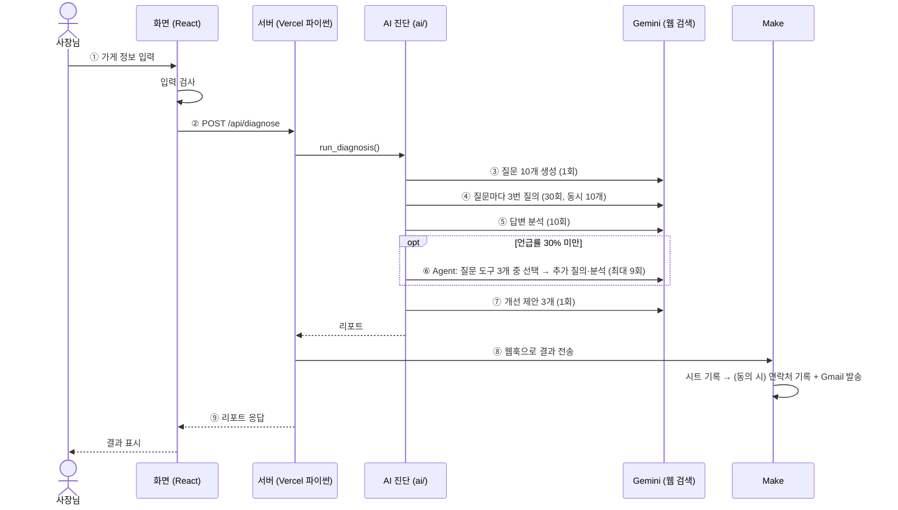

# 동작 설명: 버튼 한 번에 무슨 일이 일어나나

> 팀장 작성 · 2026-10-29 · 멘토 요청 5 "결과물이 어떻게 동작하는지 설명" 준비 자료 (5분 설명용)
> AI 단계의 자세한 설명: [AI 한눈에 보기](AI_한눈에보기.md) · 화면↔서버 약속: [API 명세](API_명세.md)

## 1. 한 문장

사장님이 가게 정보를 넣으면 → 서버가 Gemini에게 **손님인 척 질문 10개를 3번씩** 묻고 → 답변에 우리 가게가 몇 번 나오는지 세어 → 부족하면 **AI Agent가 원인을 더 묻고** → 개선 제안 3개를 화면에 돌려준다. 동시에 **Make가 결과를 시트에 적고 메일로 보낸다.**

## 2. 전체 흐름: "진단 시작하기"

## 3. 단계별: 무엇을, 왜

| 단계 | 무엇을 | 왜 이렇게 | 코드 |
| :-: | --- | --- | --- |
| ① | 필수 칸·메뉴 1~3개·이메일 형식·동의 여부 검사 | 잘못된 입력으로 AI를 부르면 돈·시간 낭비 → 보내기 전에 막음 | `geo_frontend/src/main.jsx` |
| ② | 서버가 요청 형식 확인 → AI 진단 실행 | **API 키를 브라우저에 두면 누구나 볼 수 있음** → 키는 서버에만 둠. 서버는 요청이 올 때만 켜지는 방식(서버리스) | `api/diagnose.py` |
| ③ | 손님 말투 질문 10개 (지역 일반 2·메뉴 3·상황 3·조건 2). 규칙을 어기면 다시 생성 | 손님은 가게 이름을 모르고 "망원동 돈까스 맛집"처럼 물음 → 상호를 넣지 않음 | `ai/question_generator.py` |
| ④ | 질문마다 3번, 웹 검색 켜고 질의 | AI 답은 매번 달라 평균으로 판단 / 동네 가게는 검색 없이는 AI가 모름 / 300초 제한 때문에 동시에 보냄 | `ai/diagnosis.py` `run_queries()` |
| ⑤ | 언급 여부·순위·소개 문구·함께 나온 가게. 언급률 = 언급된 답변 ÷ **정상 답변** | 호출 실패를 "언급 없음"으로 잘못 세지 않으려고 실패는 분모에서 뺌 | `ai/diagnosis.py` `analyze_all()` `summarize()` |
| ⑥ | **할지 말지는 규칙**(30% 미만), **무엇을 물을지는 AI**: 질문 도구 3개를 함수로 주면 Gemini가 1~2개를 골라 이유와 함께 호출 | 평가 기준 "AI가 2개 이상의 도구 중 스스로 고름" 충족 / AI가 가게를 **모르는지**, **알지만 추천을 안 하는지** 구분 | `ai/agent.py` `run_agent()` |
| ⑦ | 개선 제안 3개 (제목·할 일·근거) | 근거는 진단 결과 안의 숫자·가게 이름만 → "노출 30% 상승" 같은 근거 없는 약속 방지 | `ai/diagnosis.py` `suggest()` |
| ⑧ | 서버가 Make 웹훅(Make가 열어 둔 수신 주소)으로 결과 전송 → 시트 기록, 동의한 경우만 메일 | 시트·메일 연결을 코드 없이 / 평가 기준 "이벤트로 시작해 2개 이상 서비스가 사람 없이 이어짐" 충족. Make가 실패해도 화면 결과는 그대로 | `server/make_sender.py` |
| ⑨ | 화면이 리포트를 받아 결과 표시 | 입력 오류·AI 실패도 사장님 말로 안내 | `geo_frontend/src/main.jsx` |

## 4. "더 자세히 진단하기" 버튼

- 언급률이 30% 이상이라 ⑥이 자동으로 안 돌았을 때만 버튼이 보임
- 서버는 요청이 끝나면 내용을 잊음 → **화면이 1차 리포트를 통째로 다시 보내고**, 서버가 Agent를 1번 실행 (`api/more.py` → `run_more()`)
- 진단 1회당 추가 진단 1번 → 비용·시간 상한 유지. 완료되면 메일을 다시 보냄

## 5. 숫자로 보면

| 항목 | 값 |
| --- | --- |
| 진단 1회 AI 호출 | 최대 51번 (그중 웹 검색 36번) |
| 걸리는 시간 | 약 22~35초 (버튼 약 13초) |
| 비용 | 진단 1회 약 $0.1 (선불 충전, 자동 충전 끔) |
| 배포 | GitHub main에 합치면 Vercel이 자동으로 다시 만듦. 화면과 서버가 같은 주소 → 화면이 `/api/...`로 바로 호출 |

## 6. 예상 질문과 답

| 질문 | 답 |
| --- | --- |
| 이게 왜 Agent인가요? | 할지 말지는 규칙이 정하지만, 어떤 질문 도구를 쓸지는 Gemini가 3개 중 고름. 고른 이유가 결과에 남음 |
| 결과를 믿을 수 있나요? | 질문마다 3번 묻고, 같은 입력 3회 점검에서 3번 모두 같은 판단. 단, 실제 ChatGPT 앱 답과 다를 수 있어 화면·메일에 고지 |
| 진단 결과는 어디 저장되나요? | Vercel은 파일을 남길 수 없음 → Make가 구글 시트에 요약만 기록. 답변 원문은 하나가 수천 자라 제외 |
| 이메일은 어떻게 다루나요? | 동의한 경우에만 사용, AI에는 넘기지 않음, 2026-11-24 파기 |
| 다른 AI도 진단할 수 있나요? | Gemini 호출이 `ai/gemini_client.py` 한 곳에 모여 있음 → 그 파일만 늘리면 됨 |

## 7. 5분 설명 순서

| 시간 | 말할 것 |
| --- | --- |
| 1분 | 문제(손님이 AI에게 맛집을 물음, 사장님은 확인 방법 없음) + 1장 한 문장 |
| 2분 | 2장 그림을 ①~⑨ 순서로 따라가며 각 단계 "왜" 한 마디씩 |
| 1분 | 필수 기술 2개: ⑥ Agent(AI가 도구를 고름), ⑧ 자동화(Make가 시트·메일) |
| 1분 | 한계(AI 답 변동, 실제 앱과 차이)와 다음 계획([PRD](../PRD.md) 결과 화면 개선) |
