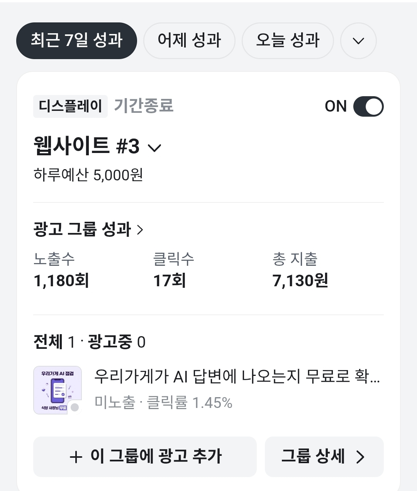

# 사용자 피드백 기록

> 팀장 작성 · 2026-10-22 양식 작성 · 2026-11-04 결과 기록 (v0.2)
> 평가기준 G5: 실사용자 **5명 이상**, 팀원 제외, 다른 팀 교육생은 외식업 운영자일 때만 인정
> 테스터 이름·연락처는 저장소에 올리지 않음 → 가명 T1, T2 … (기획서 4-5)

---

## 1. 진행 방법

| 단계 | 내용 | 담당 |
| --- | --- | --- |
| 모집 | 당근 광고로 외식업 사장님 7~8명 (필수 5명 + 이탈 대비) | 팀장 |
| 안내 | 신청한 사장님께 안내 메시지 발송: 배포 URL + 설문 링크 | 팀장 |
| 사용 | 사장님이 직접 배포 URL에서 진단 (약 1분) | 테스터 |
| 응답 | 결과 리포트 중간 팝업의 **한 줄 질문**(탭 한 번, 리포트를 이어 보려면 필수, 11/1 추가. 메일을 보낸 사람에게는 같은 팝업에서 나머지 의견을 권함) · 끝의 **의견 팝업**(5문항, 약 1분, 10/31 추가. 의견을 보내면 리포트를 메일로 받음) 또는 구글 설문(약 3분). 팝업 의견은 진단 가게·지역·메뉴·언급률과 함께 피드백 시트에 자동 기록(이름·이메일은 시트에 넣지 않음) | 테스터 |
| 기록 | 설문 응답을 3장 표로 옮기고, 원본은 이름·연락처를 가려 `docs/피드백_원본/`에 저장 | 팀장 |
| 반영 | 반영할 의견은 담당 팀원이 수정 → 커밋 링크와 수정 전후 화면을 3장 표에 기록. 반영 못 한 의견은 이유 기록 | 해당 담당 |

- 일정: 계획은 10/23~25였으나 모집이 늦어짐 → 실제: 10/27 모집 시작, 당근 광고로 10/31~11/4 사용·응답, 11/4 기록
- 진단 시각·가게명은 Make 구글 시트 `진단결과`에도 남으므로 설문 응답과 대조해 실제 사용 여부 확인

## 2. 설문 문항

| # | 질문 | 응답 형식 | 왜 묻나 |
| :-: | --- | --- | --- |
| 1 | 운영하시는 가게 업종은? | 선택 (한식·중식·일식·양식·분식·카페·주점·기타) | 타깃 해당 근거 (G5) |
| 2 | 가게가 있는 지역은? (시·구·동까지) | 단답 | 타깃 해당 근거 |
| 3 | 손님이 AI(ChatGPT 등)로 가게를 찾는다는 것을 알고 계셨나요? | 5점 척도 | 문제 정의 확인 (기획서 1장) |
| 4 | 진단 결과(언급률·함께 나온 가게)를 이해하기 쉬웠나요? | 5점 척도 + 이유 | 결과 화면 개선 |
| 5 | AI가 우리 가게를 소개한 말이 실제 가게와 맞았나요? | 맞음 / 일부 맞음 / 틀림 / 소개 없음 + 이유 | 진단 정확성 |
| 6 | 개선 제안 중 실제로 해 볼 만한 것이 있었나요? | 있음(몇 번) / 없음 + 이유 | 개선 제안 유용성 |
| 7 | 진단을 기다린 시간은 어땠나요? | 짧음 / 적당 / 김 | 속도 (서버 설정) |
| 8 | 사용하면서 불편하거나 헷갈린 점은? | 서술 | 반영 후보 |
| 9 | 이 서비스가 더 있었으면 하는 기능은? | 서술 | 반영 후보 |
| 10 | (선택) "더 자세히 진단하기"를 눌러 보셨나요? 도움이 됐나요? | 안 눌러 봄 / 도움 됨 / 안 됨 | Agent 기능 평가 |

- 설문에서는 이름·연락처를 묻지 않음 (가명 기록으로 충분. 리포트 메일은 서비스 화면에서 이메일만 별도 동의로 받음(11/1부터 이름은 받지 않음))

## 3. 피드백 기록

| 가명 | 타깃 근거 (업종·지역) | 일자 | 질문 | 응답 | 반영 여부 | 근거 (커밋·전후 화면) 또는 미반영 이유 |
| --- | --- | --- | --- | --- | --- | --- |
| T1 | 순대·순댓국 · 경남 창원시 마산합포구 (개○○대) | 11/1 | 한 줄 질문: AI가 소개한 말이 실제와 맞나요? | 일부 맞음 | - | 선택형 답 |
| T2 | 돈가스 · 부산 수영구 (톤○우 ○○점) | 11/1 | 한 줄 질문: AI가 소개한 말 | 맞음 | - | 선택형 답 |
| T3 | 막국수 · 부산 동래구 (주○진 ○○수) | 11/2 | 한 줄 질문: AI가 소개한 말 | 맞음 | - | 선택형 답 |
| T4 | 생선회 · 경남 김해시 (삼○○○○집) | 11/2 | 한 줄 질문: AI가 소개한 말 (진단 2회) | 일부 맞음 → 맞음 | - | 선택형 답 |
| T5 | 정식 · 부산 서구 (신○○당) | 11/3 | 한 줄 질문: AI가 소개한 말 (진단 2회) | 일부 맞음 ×2 | - | 선택형 답 |
| T5 | | 11/3 | 의견 팝업 4문항 | 이해도 3 · 소개한 말 일부 맞음 · 함께 나온 가게 일부 비슷해요 · 해 볼 개선 제안 있음 | - | 선택형 답 |
| T5 | | 11/3 | 자유 의견 | "같은 식당 이름이 지역마다 여러 개 있다 보니 저희 가게 이름을 검색했을 때 서울 지역이 우선적으로 나오는 경향이 있어요. oo식당 옆에 도시 이름 쓰는 게 좋겠어요(예: oo식당 부산)" | 반영 완료 (가게 검색 화면, 11/4) | [8670911](https://github.com/Clay-pieup/Codyssey_Final_GEO/commit/8670911) · 전후 화면 [전](images/feedback/1104_f1_before.png) / [후](images/feedback/1104_f1_after.png) · 4장 F1 |
| T6 | 숯불갈비 · 부산 부산진구 (세○정 ○○점) | 11/3 | 한 줄 질문: AI가 소개한 말 (진단 4회) | 맞음 ×4 | - | 선택형 답 |
| T6 | | 11/3 | 의견 팝업 4문항 | 이해도 3 · 소개한 말 맞음 · 함께 나온 가게 일부 비슷해요 · 해 볼 개선 제안 없음 | - | 선택형 답 |
| T7 | 뷔페 · 부산 해운대구 (그○○○플) | 11/3 | 한 줄 질문: 함께 나온 가게가 실제와 비슷한가요? | 비슷해요 | - | 선택형 답 |
| T7 | | 11/3 | 의견 팝업 4문항 | 이해도 4 · 소개한 말 일부 맞음 · 함께 나온 가게 비슷해요 · 해 볼 개선 제안 있음 | - | 선택형 답 |
| T8 | 빙수 · 부산 남구 (용○○○○○○○○○죽 ○점) | 11/3 | 한 줄 질문: AI가 소개한 말 | 맞음 | - | 선택형 답 |
| T8 | | 11/3 | 의견 팝업 4문항 | 이해도 5 · 소개한 말 맞음 · 함께 나온 가게 비슷해요 · 해 볼 개선 제안 있음 | - | 선택형 답 |
| T9 | 팟타이 · 경남 김해시 (타○찬 ○○점) | 11/4 | 한 줄 질문: 함께 나온 가게 | 일부 비슷해요 | - | 선택형 답 |
| T9 | | 11/4 | 의견 팝업 4문항 | 이해도 4 · 소개한 말 일부 맞음 · 함께 나온 가게 일부 비슷해요 · 해 볼 개선 제안 있음 | - | 선택형 답 |

- 한 사람의 의견이 여러 개면 줄을 나눠 적음
- 응답 원본: [`docs/피드백_원본/1104_피드백시트.csv`](피드백_원본/1104_피드백시트.csv) (피드백 시트 35줄 전체. 가게 이름은 일부 가림, 지역은 시·구까지만. 피드백 시트에는 이름·이메일 칸이 없고, 이메일이 있는 연락처 시트는 올리지 않음)
- 가게 이름 괄호 안은 일부를 가린 이름 (같은 가게의 여러 응답을 묶어 보기 위해 남김)
- "의견 팝업 4문항": 한 줄 질문에서 답한 문항은 빼고 물음 (11/1 변경). 5번 자유 의견은 선택

## 4. 요약 (11/4 기준)

- **참여: 9명** (T1~T9, 목표 5명 이상 달성). 외식업 사장님, 부산 6명 · 경남 3명. 한 줄 질문만 답한 4명(T1~T4), 의견 팝업까지 답한 5명(T5~T9)
- **집계에서 뺀 응답** (원본 파일 "분류" 칸): 팀 테스트 12줄(자유 의견 "테스트", 평가자용 테스트 상호, 당근 유입 의견이 0건이던 11/1 이전 확인용), 외식업이 아닌 가게 1줄, 실제 사장님인지 판별할 수 없는 3줄
- **PRD 성공 기준과 비교** (의견 팝업까지 답한 5명 기준)
  - 결과 이해도 평균 **3.8점** (목표 4점 이상 → 미달)
  - 해 볼 만한 개선 제안 "있음" **4/5명 = 80%** (목표 60% 이상 → 달성)
  - AI가 소개한 말 (9명, 사람마다 마지막 답): 맞음 5 · 일부 맞음 4 · 틀림 0

**피드백 우선순위와 반영** (11/6. 순위 기준: 해당 인원 × 핵심 흐름에 미치는 영향 × 고치는 비용)

| 순위 | 의견·관찰 | 분류 | 근거 | 결정 | 반영 근거 또는 미반영 이유 |
| :-: | --- | --- | --- | --- | --- |
| 1 | (행동 관찰) 의견을 남기지 않음. 의견 팝업이 긴 리포트 맨 끝에만 있었음 | 사용 흐름 | 11/1 당근 유입 10명 중 의견 0건 | 반영 완료 | 리포트 중간에서 한 가지만 묻기 [7d58697](https://github.com/Clay-pieup/Codyssey_Final_GEO/commit/7d58697) → 중간 팝업, 탭 한 번 필수 [b3f1a15](https://github.com/Clay-pieup/Codyssey_Final_GEO/commit/b3f1a15) → 메일 보낸 사람에게 나머지 의견 권유 [838affc](https://github.com/Clay-pieup/Codyssey_Final_GEO/commit/838affc). 바꾼 뒤 9명 응답 |
| 1 | 개선 피드백 F1: 같은 이름 가게가 여러 지역에 있어 다른 지역 가게만 검색됨 | 정확성 (가게 검색) | T5 자유 의견 + 배포 사이트에서 재현 | 반영 완료 (화면) · AI 개선 제안 쪽은 미반영 | 검색 결과마다 지역 표시 + 다시 검색 안내 [8670911](https://github.com/Clay-pieup/Codyssey_Final_GEO/commit/8670911). AI 판정은 기존 규칙("다른 지역의 같은 이름 가게는 언급이 아니다")으로 반영돼 있음. 아래 F1 |
| 2 | 결과 이해도 평균 3.8점 (PRD 목표 4점 이상 미달) | 이해도 | 의견 팝업까지 답한 5명 중 2명(T5·T6)이 3점, 이유를 적은 사람 없음 | 미반영 (이유 기록) | 표본이 5명이고 3점을 준 이유 응답이 0건이라 어느 부분이 어려웠는지 특정할 수 없음. 근거 없이 화면을 바꾸면 이해도가 높았던 사장님(4~5점 3명)의 흐름을 해칠 수 있어, 원인을 확인한 뒤 고치기로 함 |
| 3 | 노출률 0%(소개한 말 없음)인데 "AI가 소개한 말이 맞았나요?"를 받아 "일부 맞음"으로 답함 | 설문 설계 | T7·T9 2명 | 반영 완료 | 소개한 말이 없으면 그 질문을 빼고 "소개 없음"으로 보냄 [f733940](https://github.com/Clay-pieup/Codyssey_Final_GEO/commit/f733940) |
| 4 | 같은 가게를 여러 번 진단, 결과가 조금씩 다름 | 정확성 (AI 답변 변동) | T4 2회 · T5 3회 · T6 5회 (22~40%) | 미반영 (기존 설계로 대응) | 결과 화면에 "AI가 생성한 추정치" 안내가 있고, 질문마다 3번씩 물어 집계해 흔들림을 줄이도록 설계돼 있음 |

- 같은 테스터에게 다시 확인하지 않은 이유: 받은 동의의 이용 목적이 "진단 리포트 메일 발송" 하나라, 추가 질문 메일은 목적 밖 사용이 됨

**개선 피드백 F1** (T5 · 11/3 · 정식 · 부산 서구)
- 의견: "같은 식당 이름이 지역마다 여러 개 있다 보니 저희 가게 이름을 검색했을 때 서울 지역이 우선적으로 나오는 경향이 있어요. oo식당 옆에 도시 이름 쓰는 게 좋겠어요(예: oo식당 부산)"
- 해석: ① 우리 서비스의 가게 검색 결과에 서울의 같은 이름 가게가 먼저 나옴, 또는 ② AI 답변이 서울의 같은 이름 가게를 소개함
- 원인 확인 (11/4, 배포 사이트 가게 검색): T5 가게 이름만 검색 → 결과 5곳 모두 서울 영등포구, T5 가게는 없음 / 이름 뒤에 "부산"을 붙여 검색 → T5 가게가 첫 줄. 네이버 지역 검색은 한 번에 5곳만 주므로 흔한 이름은 다른 지역 가게로 목록이 참 → ①로 확인
- 반영 (화면, 팀장 결정 B안): 검색 안내를 "같은 이름 가게가 여러 지역에 있으면 가게 이름 뒤에 도시나 동네를 붙여 검색"으로 보강, 결과마다 이름 옆에 지역("서울 영등포구") 표시, 목록 바로 아래에 "우리 가게가 목록에 없나요? 이름 뒤에 도시나 동네를 붙여 다시 검색" 안내 → [8670911](https://github.com/Clay-pieup/Codyssey_Final_GEO/commit/8670911)
- 전후 화면 (가게 이름은 ○○로 가림): [수정 전](images/feedback/1104_f1_before.png) · [수정 후](images/feedback/1104_f1_after.png)
- 버린 방법: 안내 문구만 고치기(전에도 "가게 이름과 동네를 함께" 안내가 있었지만 이름만 검색함), 검색 전에 시·도 고르기(입력 단계 늘어남), 휴대폰 위치로 자동 맞춤(위치 권한 = 개인정보)
- AI 쪽: 판정은 반영돼 있음. 답변 분석 규칙에 "다른 지역의 같은 이름 가게는 언급이 아니다"가 있어 다른 지역 가게가 나와도 우리 가게 노출로 세지 않음 ([`ai/prompts/answer_analysis.md`](../ai/prompts/answer_analysis.md)). 개선 제안에 "가게 이름과 지역 함께 쓰기"를 넣는 것은 **미반영** (11/6 팀장 결정): 분석 결과에 "다른 지역 같은 이름 가게가 나왔다"는 칸이 없어 프롬프트만 고치면 근거 없는 제안이 되고(개선 제안 규칙: 근거는 진단 결과 안에서만), 같은 뿌리인 "흔한 동 이름" 문제를 AI 담당이 알려진 한계로 기록해 둠(11/2 AI 작업 기록) → 제출 뒤 과제

- 요약은 README 7장(결과)에 옮김

## 5. 모집 기록: 당근 광고

| 항목 | 값 (11/4 캡처, 최근 7일) |
| --- | --- |
| 광고 | 당근 디스플레이 광고 "웹사이트 #3" (기간 종료), 하루 예산 5,000원 |
| 광고 문구 | "우리가게가 AI 답변에 나오는지 무료로 확…" (캡처에서 잘림) |
| 노출 → 클릭 | 1,180회 → 17회 (클릭률 1.45%) |
| 총 지출 | 7,130원 (클릭 1회당 약 419원) |

- 11/1 당근 유입 10명 중 의견 0건 → 피드백 받는 방식을 바꿈: 리포트 중간 팝업의 한 줄 질문(탭 한 번 필수), 메일을 보낸 사람에게만 나머지 의견 권유 ([진행 기록](진행기록.md) 11/1)
- 바꾼 뒤(11/1 밤~11/4): 실사용자 9명이 의견을 남김 (3장, 4장)
