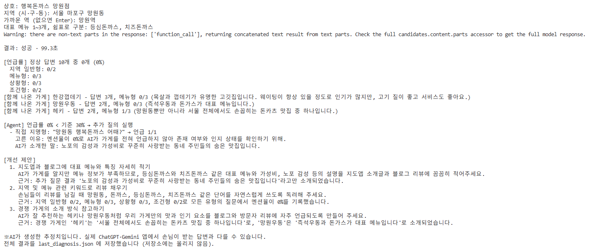
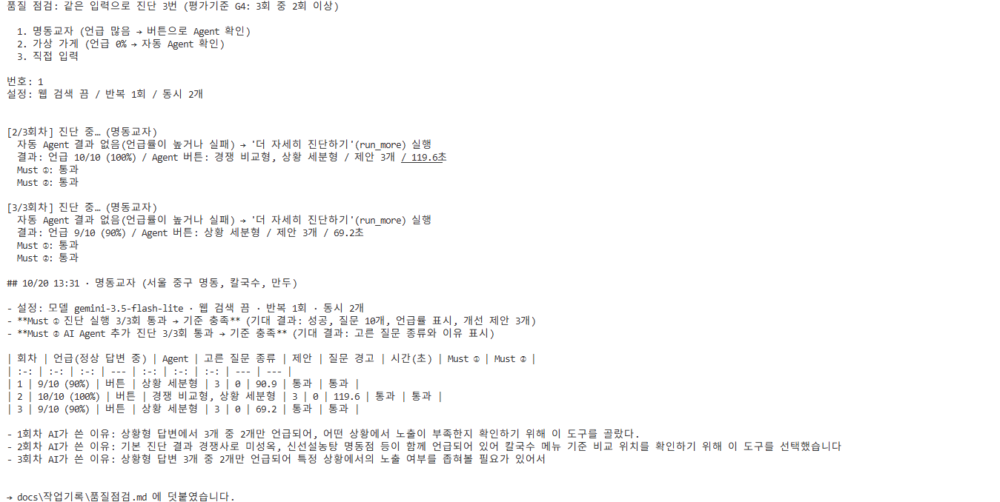
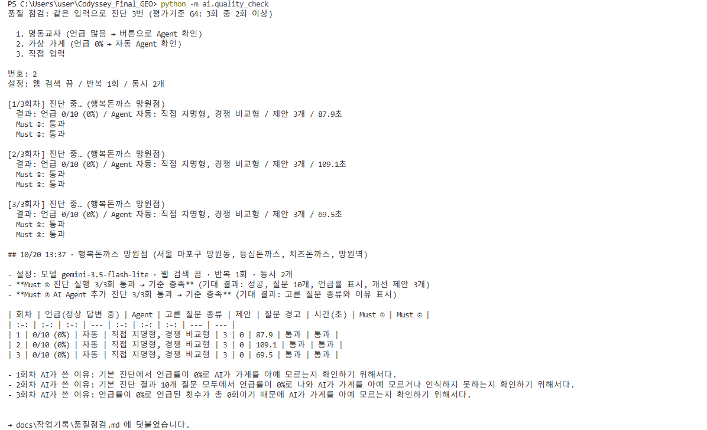
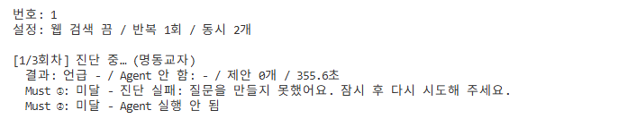
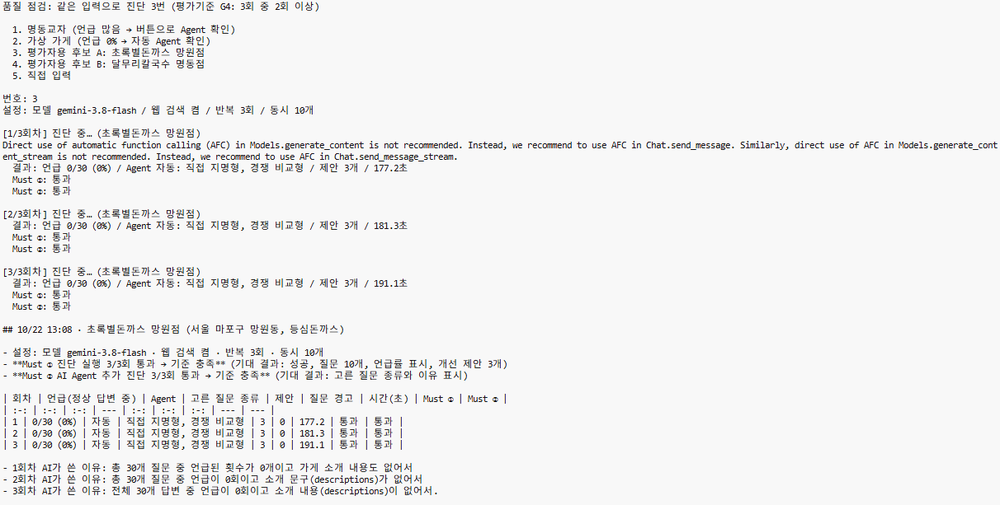
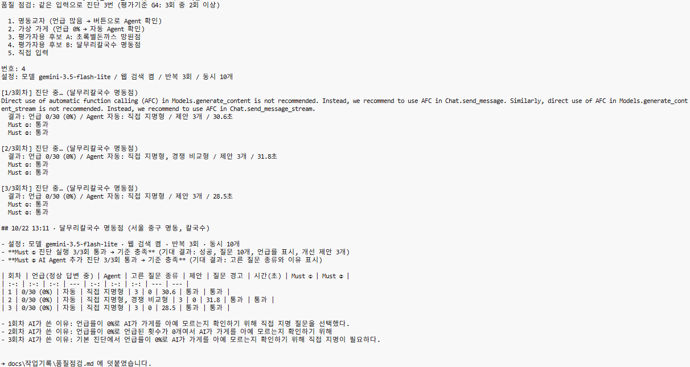
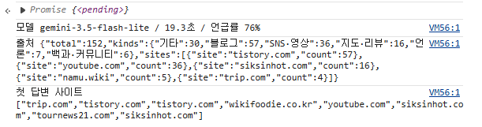

# AI 담당 작업 기록

> 협업 가이드 5장 양식. 작업 단위가 끝날 때마다 맨 아래에 추가합니다.
> 문서 초안과 코드 뼈대는 Claude와 함께 작성했고, 검토·결정·수정은 AI 담당이 직접 했습니다.

---

## 10/17 · 질문 세트와 측정 기준 설계

- 무엇을 만들었나:
  - 가게 정보로 만들 손님 질문 10개의 유형·개수·문장 규칙, 답변에서 가게 언급을 판정하고 언급률·순위·묘사·경쟁 가게를 세는 기준 → [`docs/질문세트_측정기준.md`](../질문세트_측정기준.md)
  - 규칙 검증용 업종별 예시: 가상 가게 5곳(고깃집·베이커리·국밥·중식·양식 / 서울·부산·대전)의 질문 10개씩 → [`docs/질문세트_예시.md`](../질문세트_예시.md)
- 왜 이렇게 만들었나:
  - 기본 질문에 상호를 넣지 않음 → 손님은 가게 이름을 모르고 "망원동 돈까스 맛집"처럼 물음. 그때 AI가 우리 가게를 꺼내는지가 측정 대상
  - 유형별 개수 고정 (지역 일반 2 · 메뉴 3 · 상황 3 · 조건 2) → 가게끼리, 재진단끼리 비교 가능. "메뉴로 찾는 질문 0/9"처럼 어디서 빠지는지 보여 줄 수 있음
  - 언급 판정은 코드 + AI 두 단계 → 코드는 띄어쓰기·"돈가스/돈까스" 표기 차이를 확실히 잡고, AI는 약칭과 다른 지역의 같은 이름 가게를 가려냄
  - 언급률 분모는 정상 답변 수 → 호출 실패가 "언급 없음"으로 잘못 계산되지 않게 (팀 채택, 기획서 v0.7 반영)
  - 가까운 역은 사장님이 선택 입력 → AI가 역을 추측해 틀린 역이 질문에 들어가는 것 방지 (팀 채택, 기획서 v0.7 반영)
  - 업종별 예시는 일부러 까다로운 입력(역 없음, 메뉴 1개·3개, 지점명 포함, "성수동2가", 서울 외 지역)으로 구성 → 규칙의 빈 곳을 찾기 위해
- 고민한 다른 방법과 버린 이유:
  - 질문 10개를 템플릿으로 고정 → 업종마다 손님 말투가 달라 어색함. 대신 문장은 AI가 만들고 개수·규칙은 코드가 검사
  - 언급 판정을 키워드 검색만으로 → 같은 이름의 다른 지역 가게, "행복한 돈까스" 같은 일반 표현을 구분 못 함
  - 언급 판정을 AI만으로 → 같은 답변에 판정이 흔들릴 수 있음. 코드 판정과 비교해 불일치를 기록하기로 함
- 확인 방법과 결과:
  - 진단 예시 문서(행복돈까스) 1단계 데이터로 계산 → 전체 4/30 = 13%, 상황형만 44%로 예시 문서 결과와 일치
  - 업종별 예시 5곳 모두 4개 유형·10개로 작성 가능. 규칙 보완점 7개 발견 → 5개 반영
    - "성수동2가" → "성수동" (1가·2가·3가 제거) / 프롬프트에서 "서울의" 삭제 / 메뉴 3개면 앞 2개를 메뉴형에 사용 / 상위 분류는 손님 말투로 ("중식당" → "중국집") / 지점명을 뺀 상호 앞부분도 질문에 들어가지 않게 검사
- 핵심 원리 (왜 이렇게 동작하는지): 서비스가 재는 것은 "가게를 모르는 손님이 물었을 때 AI가 우리 가게를 꺼내는가". 그래서 질문은 손님 입장으로 만들고(상호 없음, 지역 필수), 측정은 답변 단위로 센다(한 답변에 여러 번 나와도 1건)
- 막혔던 점과 해결:
  - 같은 가게가 "행복 돈까스", "행복돈가스(망원점)"처럼 다르게 나옴 → 표기 통일 규칙(공백·특수문자 제거, 돈가스/돈까스 통일, 지점명 제거)을 만들고 판정 사례 7개로 정리
  - 가상 가게는 AI 답변에 나올 수 없어 언급률이 항상 0% → 예시는 질문 생성 검증용으로만 쓰고, 품질 점검은 실존 식당 5곳으로 하기로 함
  - 문서와 프롬프트 파일에 같은 프롬프트를 두 번 써서 내용이 달라짐 (팀장 리뷰) → 문서의 프롬프트 블록을 지우고 `ai/prompts/` 파일 링크로 교체
- 관련 PR:

## 10/17 · ai 폴더 뼈대와 프롬프트 파일 분리

- 무엇을 만들었나:
  - `ai/gemini_client.py`: Gemini 호출을 함수 하나(`ask_gemini`)로 모음. 실패 시 1회 재시도, 걸린 시간 기록, 웹 검색 출처 추출. 결과(`GeminiResult`)에 `provider`·`model` 칸 포함
  - `ai/prompts/`: 질문 생성·답변 분석 프롬프트 파일 + 변경 이유를 남기는 `CHANGELOG.md`
  - `ai/prompt_loader.py`: 프롬프트 파일의 빈칸(`$dong` 등)을 채움
  - `ai/check_setup.py`: 설치·프롬프트·API 연결을 한 번에 확인
  - `.env.example`, `requirements.txt`
- 왜 이렇게 만들었나:
  - AI 호출을 한 파일에 모음 → 기획서 4-1 결정. 나중에 ChatGPT·Claude도 같은 모양의 함수만 추가
  - 결과에 `provider`·`model` 기록 → 2차에 다른 AI를 붙였을 때 어느 AI의 답인지 구분 (팀장 리뷰 반영)
  - 기본 모델을 Gemini 3 계열(`gemini-3.8-flash`)로 → 웹 검색 월 5,000회 무료가 Gemini 3 이상 모델 기준이라, 2.5 계열을 쓰면 비용 계산이 달라짐 (팀장 리뷰 반영)
  - 걸린 시간을 결과에 포함 → Vercel 실행 1회 300초 제한 안에 진단 1회 호출(10/20 정정: 최대 51회)이 들어가는지 실측에 바로 사용
  - 프롬프트를 코드 밖 파일로 → 프롬프트만 고칠 때 코드를 건드리지 않고, 바꿀 때마다 이유를 CHANGELOG에 남김
  - 모델 이름을 `.env`로 바꿀 수 있게 → 실측 결과에 따라 코드 수정 없이 교체 (예: Flash-Lite 계열)
- 고민한 다른 방법과 버린 이유:
  - LangChain 같은 프레임워크 → 호출 단계가 단순해 필요 없고, 동작을 설명하기 어려워짐. Gemini 공식 SDK(google-genai)를 직접 사용
  - 프롬프트 빈칸을 `{dong}` 형식으로 → 프롬프트 안의 JSON 예시 `{"questions": ...}`와 충돌. `$dong` 형식으로 바꿈
  - 기본 모델 `gemini-2.5-flash` → 웹 검색 과금 방식이 달라 위 이유로 교체
- 확인 방법과 결과: `python -m ai.check_setup` 실행 → 패키지 확인 OK, 프롬프트 빈칸 채우기 OK, API 호출은 키 받은 뒤 확인 예정 (팀장도 실행 확인, 비밀값 없음 확인)
- 핵심 원리: 웹 검색(Grounding)을 켠 질의는 자유 문장으로 받고, 질문 생성·답변 분석은 JSON으로만 받음. 두 설정을 함수 옵션(`use_search`, `json_output`)으로 나눠 단계마다 골라 씀
- 막혔던 점과 해결:
  - Windows에서 zip 압축 풀기가 한글 파일 이름에서 실패 → 한글 이름 파일은 탐색기로 직접 복사
  - `git add` 때 LF/CRLF 줄바꿈 경고 → 내용과 동작에 영향 없는 안내 메시지임을 확인
  - GitHub 웹 업로드 때 파일이 `ai/prompts/` 폴더에 잘못 올라감 → 잘못 올린 파일을 지우고 `ai/` 폴더에 다시 올림
- 관련 PR:

---

## 팀 확인 필요 (10/17 기준)

- 상황 목록에 "카페 작업·공부" 추가 여부
- 팀 공용 Gemini API 키 공유 방식
- `requirements.txt`를 저장소 맨 위에 만듦 → 서버 패키지도 같은 파일에 이어서 적기
- 수요일 품질 점검용 실존 식당 5곳 (업종이 겹치지 않게)
- 기본 모델 최종 선택 (3.8 Flash vs Flash-Lite 계열) → 실측 속도·비용 보고 확정

---

## 10/19 · 질의 소요 시간 실측과 웹 검색 켬/끔 비교

- 무엇을 만들었나: 실측 스크립트 `ai/measure.py` → 실존 식당 정보를 넣으면 질문 3개 × 웹 검색 끔/켬 × 2회를 보내고 소요 시간·언급 여부·출처 수를 표로 정리. 결과는 [`실측결과.md`](실측결과.md)에 자동 저장
- 왜 이렇게 만들었나:
  - Vercel 실행 1회 300초 제한 안에 진단 1회(10/20 정정: 최대 51회 호출)가 들어가는지 판단해야 팀장 서버 구조(순차/동시 호출)가 정해짐
  - 기본 모델(3.8 Flash vs 3.5 Flash-Lite)을 고를 근거가 필요
  - 기획서의 "웹 검색을 써야 동네 식당이 나온다"는 가정을 확인
- 고민한 다른 방법과 버린 이유:
  - 질문 생성까지 연결한 전체 진단으로 재기 → 아직 미구현. 고정 질문 3개(지역 일반형·메뉴형·조건형)로 먼저 재고, 파이프라인 완성 후 다시 잼
  - 손으로 시간 재기 → 반복 측정과 기록이 어려워 스크립트로 자동화
- 확인 방법과 결과: `python -m ai.measure` 실행, 본인 무료 키, 가게 2곳(명동교자, 우래옥)
  - gemini-3.5-flash-lite, 웹 검색 끔: 12/12 성공, 평균 3.2초, 최대 4.4초 → 36회 순차 약 116초로 300초 안 (10/20 정정: 전체 51회 기준 순차 약 164초, 동시 3개 약 64초)
  - gemini-3.8-flash: 인사 1회에 17.3초 → 36회면 약 10분이라 사용 어려움 (10/20 정정: 51회면 순차 약 15분 → 쓰려면 동시 호출 필수) → 기본 모델을 3.5-flash-lite로 제안
  - 웹 검색 켬: 12/12 실패, 429 RESOURCE_EXHAUSTED(할당량 초과) → 무료 키에는 웹 검색 할당량이 없음. 같은 시간대 웹 검색 끔 호출은 모두 성공해서 호출 과다가 원인이 아님 → 켬/끔 비교는 유료 키로 재측정 필요
  - 언급 판정: 명동교자 6/6 언급, 우래옥 0/6 → 판정 코드는 정상 작동
- 핵심 원리: 순차 예상 = 평균 소요 시간 × 호출 수 (10/20 정정: 36 → 51). 웹 검색을 켜면 검색 시간이 더해지므로 켬 기준 실측이 최종 판단 기준
- 막혔던 점과 해결:
  - 3.8 Flash 첫 호출이 2분 가까이 응답이 없어 멈춘 줄 알았음 → 모델 목록 조회로 키·네트워크 정상 확인 후 재시도하니 17초 만에 응답. 느린 모델이었음 → 응답이 없을 때 끝없이 기다리지 않도록 시간 제한 추가 필요
  - 공용 컴퓨터에서 키를 넣을 때 명령어를 복사하며 클립보드의 키가 덮어써짐 → `.env`를 메모장으로 만들고, 작업이 끝나면 삭제
  - 우래옥을 "주교동"으로 물으면 6번 모두 미언급 → 손님은 "을지로"로 부르는 지역. 동 이름만으로는 부족할 수 있어 "가까운 역" 선택 입력의 근거가 됨
- 관련 PR: #10

## 10/19 · 질문 생성 기능

- 무엇을 만들었나: 상호·지역·대표 메뉴·가까운 역을 넣으면 손님 질문 10개를 만드는 기능 `ai/question_generator.py`, 표기 정리 도구 `ai/text_utils.py`
- 왜 이렇게 만들었나: 문장은 AI가 만들고(업종마다 말투가 다름), 유형별 개수·상호 미포함·지역 포함·동 이름 6개 이상 같은 규칙은 코드가 검사해서 결과를 안정시킴. 검사 실패 시 1회 재생성
- 고민한 다른 방법과 버린 이유: 프롬프트로만 규칙을 지키게 하기 → AI가 가끔 규칙을 어기는데 알아챌 방법이 없음. 코드 검사를 두면 어긴 항목을 문장으로 알려 줌
- 확인 방법과 결과: `python -m ai.question_generator` → 행복돈까스(서울 마포구 망원동, 망원역, 등심돈까스·치즈돈까스) 입력 시 1회 만에 성공. 유형별 개수 일치, 상호 0회, 동 이름 6개·역 이름 4개
- 핵심 원리: "성수동2가 → 성수동", "연산1동 → 연산동"처럼 손님이 부르는 동 이름으로 정리한 뒤 질문에 사용. 상호는 지점명을 떼고 앞 4글자까지 검사해 "부산할매" 같은 일부 노출도 막음
- 막혔던 점과 해결: 지역을 "망원점"으로 잘못 입력하자 검사에서 "동 이름이 들어간 질문 0개"로 실패 → 검사가 실수를 잡아냄. 지역에 "동"이 없으면 AI 호출 전에 입력 오류로 안내하도록 보완 예정
- 관련 PR: #10

## 10/19 · 진단 전체 흐름과 run_diagnosis()

- 무엇을 만들었나: `ai/diagnosis.py` → 입력 확인 → 질문 생성 → 질의(동시 호출) → 답변 분석 → 집계 → 개선 제안 3개 → 리포트. 서버는 `run_diagnosis()` 하나만 부르면 됨. 개선 제안 프롬프트 `ai/prompts/improvement.md` 추가, 호출 시간 제한 60초 추가
- 왜 이렇게 만들었나:
  - 질의를 동시에 보냄(기본 3개, `.env`로 조절) → 반복 3회·웹 검색 켬일 때 Vercel 300초 안에 들어오게
  - 답변 분석을 질문 단위로 묶음(답변 3개를 한 번에) → 분석 호출 30회 → 10회
  - 지역에 "동"이 없거나 상호·메뉴가 비면 AI 호출 전에 안내 → 호출 낭비 방지
  - 리포트에 "AI가 생성한 추정치" 안내 고정, Agent 판단 기록 칸을 미리 둠 → 내일 Agent를 붙여도 서버 연결은 그대로
- 고민한 다른 방법과 버린 이유: 답변마다 분석 1회 → 호출 수가 두 배가 넘어 무료 키 분당 한도와 시간 제한에 부담
- 확인 방법과 결과: `python -m ai.diagnosis` (웹 검색 끔, 반복 1회) → 명동교자(서울 중구 명동, 칼국수·만두) 23.6초에 성공. 언급 9/10(90%), 메뉴형만 2/3, 평균 1.3위·1위 5회, 개선 제안 3개 생성
- 핵심 원리: 서버 → `run_diagnosis()` → 결과 dict(JSON). 실패해도 `ok=False`와 사장님께 보여줄 문장(`error`, `problems`)을 돌려줘 화면이 멈추지 않음
- 막혔던 점과 해결: 개선 제안 근거에 진단 결과에 없는 가게 이름(목멱산방, 육대장)이 나옴 → AI가 원래 알던 내용을 근거로 씀. 프롬프트에 "근거는 진단 결과 안에서만"을 강화할 예정 (품질 점검 때)
- 관련 PR: #10

## 10/19 · AI Agent (질문 도구 3개 중 AI가 선택)

- 무엇을 만들었나: `ai/agent.py` → 언급률 30% 미만이면 질문 도구 3개(직접 지명형·경쟁 비교형·상황 세분형)를 각각 함수로 Gemini에 주고, Gemini가 함수 호출로 1~2개를 골라 질문 문장과 이유를 채움 → 코드가 규칙 검사 후 실행 → 고른 도구·이유·결과를 리포트 `agent` 칸에 기록. 함수 호출은 `ai/gemini_client.py` `choose_tools()`, 판단 프롬프트 `ai/prompts/agent_decision.md`
- 왜 이렇게 만들었나: 평가기준 G3 Agent 인정 조건 "LLM이 2개 이상의 도구·함수 중 호출 대상을 스스로 정함". 질문 문장만 AI에게 받는 방식은 "프롬프트 1회 → 응답"이라 불인정이므로, 도구를 함수로 정의하고 선택 자체를 AI가 하게 함
- 고민한 다른 방법과 버린 이유:
  - 규칙으로 도구를 고르기(예: 언급 0이면 무조건 직접 지명형) → Agent로 인정되지 않음
  - 여러 단계 반복 계획·실행 → 시간·비용 증가. 기획서 3-1의 추가 질의 1회 원칙에 맞춰 1회로 제한
- 확인 방법과 결과: `python -m ai.diagnosis`, 가상 가게 행복돈까스 망원점(웹 검색 끔, 반복 1회) → 언급률 0%로 Agent 실행, Gemini가 직접 지명형을 선택("망원동 행복돈까스 어때?"), 이유 "멘션율이 0%로 AI가 가게를 전혀 언급하지 않아 존재 여부와 인지 상태를 확인". 개선 제안 3개 모두 진단 결과의 숫자·문구를 근거로 생성 (99.3초, 무료 키 한도 대기 포함)
  - 화면: 
- 핵심 원리: AI는 도구를 "고르기만" 하고 실행은 코드가 함. 그래서 AI가 규칙을 어긴 질문(지역 없음 등)을 골라도 실행 전에 걸러지고, 걸러진 이유도 `skipped`에 남음
- 막혔던 점과 해결:
  - 무료 키 분당 15회 한도에 걸려 Agent 단계에서 429 → 한도 오류는 Google이 알려준 시간만큼 기다렸다가 최대 3번 다시 시도하도록 `gemini_client.py` 수정
  - 질문 생성이 "동 이름 6개 이상" 규칙을 2번 연속 아깝게 못 지켜 진단 전체가 멈춤 → 꼭 지킬 규칙(상호·지역·개수)과 되도록 지킬 규칙(동 이름 개수)으로 나누고, 다시 만들 때 틀린 점을 알려 주며 최대 3번 시도
  - 개선 제안 근거에 진단 결과에 없는 가게 이름이 나옴 → improvement.md v2에서 "진단 결과에 적힌 내용만 근거로" 규칙 추가 → 재실행 시 해결
  - 한계: 웹 검색을 끈 상태에서는 AI가 모르는 가상 가게를 아는 척 묘사함(직접 지명형 1/1 언급, "노포의 감성…"). 실존 가게·웹 검색 켬 상태로 품질 점검에서 재확인 예정
- 관련 PR: #10

## 10/20 · 팀장 검토 반영: "더 자세히 진단하기" 실행 경로, 호출 수 정정

- 무엇을 만들었나:
  - `ai/diagnosis.py` `run_more(report)` → 화면이 1차 리포트를 다시 보내면 Agent 추가 질의만 실행하고, Agent 결과까지 넣어 개선 제안을 다시 만든 리포트를 돌려줌. 리포트에 `more_available`(버튼 표시 여부), `more_error` 칸 추가
  - `ai/agent.py` `run_agent(force=True)` → 언급률과 관계없이 실행, `trigger`(auto / button)로 실행 방식 기록
  - 리포트 `model` 칸에 "기본값" 대신 실제 모델 이름 (`ai/gemini_client.py` `current_model()`)
  - 문서: 호출 수 36회 → 51회 정정, AI-1~9를 Must ①②의 세부 단계로 표기, 질문 생성 "1회 재생성" → "최대 3번 시도" 정정, Python 3.10 이상 명시
  - 팀장 2차 검토: 버튼 표시 조건을 "Agent를 실행 안 함"에서 "Agent 결과가 없음"으로 변경 → 자동 Agent가 429 등으로 실패해도 버튼으로 다시 시도 가능. Must 이름을 명세서와 맞춤(① 진단 실행 ② AI Agent 추가 진단 ③ 결과 자동 전달)
- 왜 이렇게 만들었나:
  - 기획서 v0.8(PR #9): 자동 추가 질의가 없는 리포트에 "더 자세히 진단하기" 버튼 → 평가자가 어떤 가게로 진단해도 Agent 동작 확인 가능
  - Vercel 서버는 요청마다 새로 시작해 1차 결과를 기억하지 못함 → 저장소 없이 화면이 가진 리포트를 다시 받는 방식
- 고민한 다른 방법과 버린 이유:
  - 버튼을 누르면 진단을 처음부터 다시 하기 → 호출 51회를 또 써서 시간·비용 두 배, 질문이 바뀌어 1차 결과와 이어지지 않음
  - 1차 결과를 구글 시트나 서버 파일에 저장해 두고 꺼내 쓰기 → Vercel은 파일을 못 남기고, 시트를 읽으려면 Make 시나리오가 하나 더 필요
- 확인 방법과 결과: 가짜 Gemini 응답으로 테스트 (실제 호출 없이 흐름만 확인)
  - 언급률 100% 진단 → Agent 실행 안 함, `more_available: true`, 호출 42회
  - 그 리포트를 JSON으로 바꿔 `run_more()`에 넣음 → Agent가 도구 2개 실행(`trigger: "button"`), 개선 제안 다시 생성, 호출 10회, `more_available: false`
  - 같은 리포트로 다시 누름 → "이미 추가 진단을 했어요" / summary가 깨진 리포트 → "진단 결과가 올바르지 않아요" / 실패 리포트 → "먼저 진단을 끝까지 실행해 주세요"
  - 언급률 0% 진단 → 자동 Agent 실행, 호출 정확히 51회 (팀장 계산과 일치)
- 핵심 원리: 서버가 상태를 기억하지 않는 대신, 리포트 자체가 상태를 들고 다님. 버튼 결과도 리포트 전체를 돌려주므로 화면·Make는 받은 리포트로 그대로 다시 그리면 됨
- 막혔던 점과 해결:
  - 호출 수를 질의만 세어 36회로 계산했음 (질문 생성·분석·Agent 선택·제안 빠짐) → 단계별로 다시 세어 51회, 버튼 포함 최대 52회. `ai/measure.py`도 51회 기준으로 수정
  - 화면이 보낸 리포트는 믿을 수 없는 값 → 입력값을 `check_input()`으로 다시 검사하고 summary 모양도 확인한 뒤 실행
  - 진단 1회당 추가 질의 1번 원칙은 서버가 기억하지 못해 완전히 막을 수 없음 → 이미 추가 질의를 한 리포트는 거절하고, 화면에서 버튼을 한 번 누르면 비활성화하도록 입출력 명세 7장에 요청
- 관련 PR: #10

## 10/20 · 품질 점검 (같은 입력 3회, 평가기준 G4)

- 무엇을 만들었나: `ai/quality_check.py` → 같은 입력으로 진단을 3번 돌려 Must ① 진단 실행(성공·질문 10개·언급률·개선 제안 3개)과 Must ② AI Agent 추가 진단(고른 질문 종류와 이유)이 몇 번 기대 결과를 냈는지 [`품질점검.md`](품질점검.md)에 표로 자동 기록. 자동 Agent 결과가 없으면 "더 자세히 진단하기"(`run_more`)까지 눌러서 확인
- 왜 이렇게 만들었나: 평가기준 G4 "Must 기능마다 3회 시도 중 2회 이상 기대 결과". 손으로 3번씩 돌리고 적으면 기록이 빠지기 쉬워 판정과 기록을 자동화
- 고민한 다른 방법과 버린 이유: 가게 5곳 × 3회 → 무료 키 분당 한도로 1곳에 5분 안팎이라 오늘은 언급이 많은 실존 가게 1곳(버튼 경로)과 가상 가게 1곳(자동 경로)으로 Agent 두 경로를 모두 확인. 실존하는 작은 가게는 유료 키 측정 때 추가
- 확인 방법과 결과: `python -m ai.quality_check`, 본인 무료 키, gemini-3.5-flash-lite, 웹 검색 끔, 반복 1회, 동시 2개
  - 명동교자(서울 중구 명동, 칼국수·만두): **Must ① 3/3, Must ② 3/3**. 언급률 90%·100%·90%로 회차 간 차이 작음. 3번 모두 자동 Agent 없음 → 버튼으로 Agent 실행, AI가 상황 세분형(상황형 3개 중 2개만 언급) 또는 경쟁 비교형(미성옥·신선설농탕이 함께 나옴)을 선택. 69~120초
  - 행복돈까스 망원점(가상 가게, 망원역): **Must ① 3/3, Must ② 3/3**. 언급률 3번 모두 0% → 자동 Agent 실행, 3번 모두 직접 지명형 + 경쟁 비교형 선택, 이유도 매번 "언급률 0% → 가게를 아는지 확인". 70~109초
  - 화면:  
- 핵심 원리: 언급률이 극단적인 가게(0%, 90% 이상)는 판단이 매번 같고, 중간 가게일수록 AI가 고르는 도구가 달라질 수 있음 → 평가자 확인용 입력은 실존하지 않는 상호(항상 0% → 자동 Agent)가 가장 안정적 (기획서 3-1과 일치)
- 막혔던 점과 해결:
  - 첫 실행이 1회차에 356초 걸린 뒤 "질문을 만들지 못했어요"로 실패 → `.env`에 모델을 적지 않아 기본값 3.8-flash(호출 1회 17초)로 돌았고, 질문 생성 호출이 60초 시간 제한에 반복해서 걸림 → `GEMINI_MODEL=gemini-3.5-flash-lite`로 다시 실행해 해결 (실패 화면: ). 점검 시작 화면에 모델 이름을 보여 주고, 실패하면 원인(시간 초과·한도 초과)을 표에 함께 적도록 스크립트 보완
  - 한계: 웹 검색 끔·반복 1회 조건. 배포 조건(웹 검색 켬·반복 3회)은 유료 키로 다시 점검
- 관련 PR: #10

## 10/22 · 배포 후 피드백 반영: 출처 분류, 기본 모델, 평가자용 테스트 상호

- 무엇을 만들었나:
  - 출처 분류: `ai/gemini_client.py` `_extract_sources()`가 출처 주소와 함께 원래 사이트 이름(domain 또는 title)을 `source_sites`로 저장 → `ai/diagnosis.py` `summarize()`가 사이트 이름으로 종류(블로그·지도·리뷰·언론·SNS·영상·백과·커뮤니티·기타)를 나누고, 자주 나온 사이트 상위 5곳(`summary.sources.sites`)도 기록
  - 기본 모델 `DEFAULT_MODEL`을 `gemini-3.8-flash` → `gemini-3.5-flash-lite`
  - `.env.example`에 `MAKE_WEBHOOK_URL` 추가 (서버가 사용)
  - `ai/quality_check.py`에 평가자용 테스트 상호 후보 2개 추가, `ai/measure.py` 결과에 출처 사이트 이름 표시
- 왜 이렇게 만들었나:
  - 배포 환경 명동교자 진단에서 출처 131개가 모두 "기타" → Gemini가 주소를 Google 중간 주소(`grounding-api-redirect`)로 줘서 주소로는 원래 사이트를 알 수 없었음. 출처 정보에 들어 있는 사이트 이름을 쓰면 분류 가능
  - 3.8-flash는 호출 1회 17초(10/19)와 품질 점검 중 시간 초과(10/20) 기록 → 측정 전까지 빠른 모델을 기본값으로 (팀장 요청)
  - 기획서 3-1 평가자 확인용 입력: 기존 가상 상호 "행복돈까스"는 웹 검색에 같은 이름 가게(다른 지역 당근 프로필 등)가 나와, 웹 검색 켬에서는 언급률 0%가 보장되지 않음
- 고민한 다른 방법과 버린 이유: 중간 주소를 하나씩 열어 원래 주소 확인 → 출처 131개마다 호출이 추가되어 시간 증가, 배포 환경에서 외부 접속 실패 위험
- 확인 방법과 결과: 가짜 Gemini 응답(중간 주소 + 사이트 이름 9개)으로 테스트 → 블로그 3·지도·리뷰 2·언론 1·SNS·영상 1·백과·커뮤니티 1·기타 2로 분류, 예전 모양 리포트(source_sites 없음)도 주소로 분류. 실제 출처 이름이 이 모양으로 오는지는 유료 키 측정 때 확인 예정
- 핵심 원리: 주소(uri)는 Google을 거치는 중간 주소여도, 출처 정보의 제목(title)에는 보통 원래 사이트 이름이 들어 있음
- 관련 PR: #14

## 10/22 · 유료 키 점검: 평가자용 테스트 상호, 두 모델 시간 비교

- 무엇을 했나: 평가자용 테스트 상호 후보 2개를 웹 검색 켬·반복 3회·동시 10개로 `python -m ai.quality_check` 3회씩 점검 ([품질점검.md](품질점검.md))
- 왜: 기획서 3-1 "명세서 확인 방법에 실존하지 않는 테스트용 상호 지정 → 언급률 0% → 자동 추가 질의가 항상 실행". 웹 검색을 켜도 0%가 나와야 평가자가 언제 해도 같은 결과를 봄
- 확인 결과:
  - 초록별돈까스 망원점 (gemini-3.8-flash): 3회 모두 언급 0/30 → 자동 Agent(직접 지명형·경쟁 비교형), **Must ①② 3/3**, 진단 1회 177~191초
  - 달무리칼국수 명동점 (gemini-3.5-flash-lite): 3회 모두 언급 0/30 → 자동 Agent(직접 지명형, 1회는 경쟁 비교형 추가), **Must ①② 3/3**, 진단 1회 28~32초
  - 가상 가게를 아는 척하는지: 웹 검색 켬에서는 기본 질문 30개 × 3회 모두 언급 0회 → 아는 척하지 않음 (10/19 웹 검색 끔에서는 아는 척했음)
  - 두 모델 시간: 같은 조건에서 3.8-flash가 약 6배 느리고 Vercel 300초 제한에 가까움 → 기본 모델 3.5-flash-lite가 맞음
  - 화면:  
- 막혔던 점과 해결:
  - 처음에 본인 무료 키로 돌려 웹 검색 질의 30개가 모두 429 → 유료 키로 바꿔 해결 (무료 키에는 웹 검색 할당량이 없음, 10/19 실측과 같은 원인)
  - `.env` 모델 이름을 `3.8-flash`, `3.5-flash-lite`처럼 `gemini-` 없이 적어 질문 생성이 4초 만에 실패 → `gemini-3.8-flash`, `gemini-3.5-flash-lite`처럼 `gemini-`를 붙여 해결
    - AI Studio 사용량의 10/22 "404 NotFound" 약 40회(비용 없음)가 이 실행 → 없는 모델 이름이라 404, 질문 생성 3번 시도 × 재시도 1회 × 3회차 = 실행 1번에 18회 → 두 모델 이름을 모두 잘못 적어 2번 실행해 약 40회 (팀장 확인 요청으로 원인 기록)
    - 보완: 404·400·키 오류처럼 다시 보내도 똑같은 오류는 재시도하지 않고 바로 멈춤, 리포트 `problems`에 "모델 이름을 확인해 주세요" 안내 → 같은 실수 때 404는 실행 1번에 1회 (`ai/gemini_client.py` `is_permanent_error()`)
  - "행복돈까스"는 웹 검색에 같은 이름 가게가 나와 평가자용에서 제외
- 관련 PR: #14 (404 보완은 다음 PR)

## 10/23 · 배포 환경에서 출처 분류 확인, 404 재시도 방지

- 무엇을 했나:
  - 배포 주소 브라우저 콘솔에서 `/api/diagnose`로 명동교자 진단 1회 → 출처가 사이트 이름으로 분류되는지 확인 (PR #14 배포 후)
  - 10/22 AI Studio 404 약 40회 원인 기록, 다시 보내도 같은 오류는 재시도하지 않게 보완 (PR #15)
- 확인 결과 (gemini-3.5-flash-lite, 웹 검색 켬, 19.3초, 언급률 76%):
  - 출처 152개 → 블로그 57 · SNS·영상 36 · 지도·리뷰 16 · 언론 7 · 백과·커뮤니티 6 · 기타 30 (10/22 배포에서는 131개 모두 "기타")
  - 자주 나온 사이트: tistory.com 57 · youtube.com 36 · siksinhot.com 16 · namu.wiki 5 · trip.com 4
  - 화면: 
- 알게 된 점: Gemini 웹 검색 출처에는 네이버 블로그보다 티스토리·유튜브가 많이 나옴 → 개선 제안에서 "티스토리·유튜브 후기"를 근거로 쓸 수 있음
- 보완: "기타"로 빠진 trip.com, wikifoodie 같은 여행·맛집 리뷰 사이트를 지도·리뷰 키워드에 추가
- 관련 PR: #15

### 화면 기록 (docs/images/ai/)

| 순서 | 날짜 | 작업 | 화면 | 파일 |
| :-: | --- | --- | --- | --- |
| 1 | 10/19 | 질의 소요 시간 실측 | 명동교자 12회 측정 | [1019_measure_myeongdong.png](../images/ai/1019_measure_myeongdong.png) |
| 2 | 10/19 | 질의 소요 시간 실측 | 우래옥 12회 측정 | [1019_measure_uraeok.png](../images/ai/1019_measure_uraeok.png) |
| 3 | 10/19 | 질의 소요 시간 실측 | 실측 결과 표 | [1019_measure_result.png](../images/ai/1019_measure_result.png) |
| 4 | 10/19 | 질문 생성 기능 | 지역 오타를 검사가 잡음 (실패) | [1019_questions_check_fail.png](../images/ai/1019_questions_check_fail.png) |
| 5 | 10/19 | 질문 생성 기능 | 행복돈까스 질문 10개 (성공) | [1019_questions_success.png](../images/ai/1019_questions_success.png) |
| 6 | 10/19 | 진단 전체 흐름 | 명동교자 진단 결과 | [1019_diagnosis_myeongdong.png](../images/ai/1019_diagnosis_myeongdong.png) |
| 7 | 10/19 | AI Agent | 행복돈까스 Agent 실행 (직접 지명형 선택) | [1019_agent_direct_name.png](../images/ai/1019_agent_direct_name.png) |
| 8 | 10/20 | 품질 점검 | 모델을 안 적어 3.8-flash로 돌다 질문 생성 시간 초과 (실패) | [1020_quality_timeout_fail.png](../images/ai/1020_quality_timeout_fail.png) |
| 9 | 10/20 | 품질 점검 | 명동교자 3회 (버튼으로 Agent, Must ①② 3/3) | [1020_quality_myeongdong.png](../images/ai/1020_quality_myeongdong.png) |
| 10 | 10/20 | 품질 점검 | 가상 가게 3회 (자동 Agent, Must ①② 3/3) | [1020_quality_fake_store.png](../images/ai/1020_quality_fake_store.png) |
| 11 | 10/22 | 테스트 상호 점검 | 초록별돈까스 망원점 3회 (웹 검색 켬, 3.8-flash, 0%·자동 Agent) | [1022_testname_chorokbyeol.png](../images/ai/1022_testname_chorokbyeol.png) |
| 12 | 10/22 | 테스트 상호 점검 | 달무리칼국수 명동점 3회 (웹 검색 켬, 3.5-flash-lite, 0%·자동 Agent) | [1022_testname_dalmuri.png](../images/ai/1022_testname_dalmuri.png) |
| 13 | 10/23 | 배포 확인 | 명동교자 출처 152개 사이트 이름으로 분류 | [1023_deploy_sources.png](../images/ai/1023_deploy_sources.png) |

- 화면을 새로 찍으면 이 표 아래에 한 줄씩 추가합니다. 파일 이름은 `날짜_기능_내용.png` (영어·숫자만)
